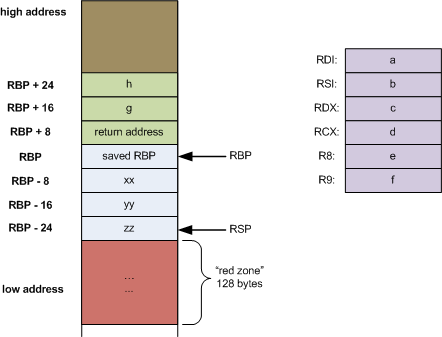
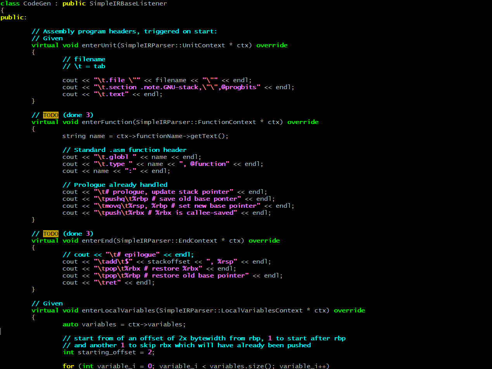
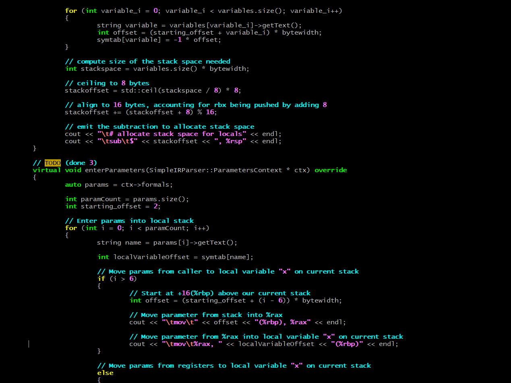
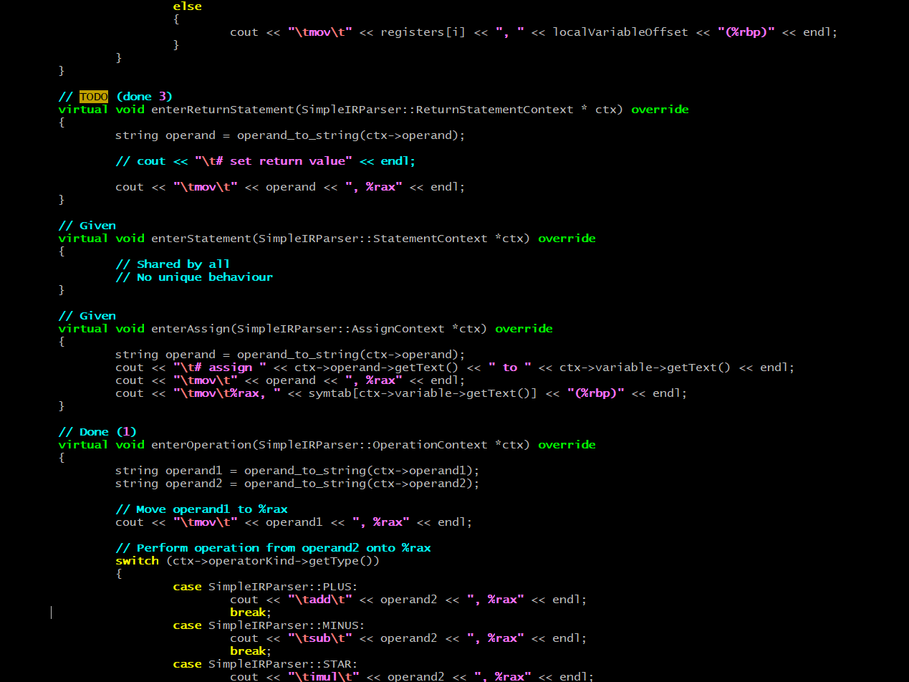
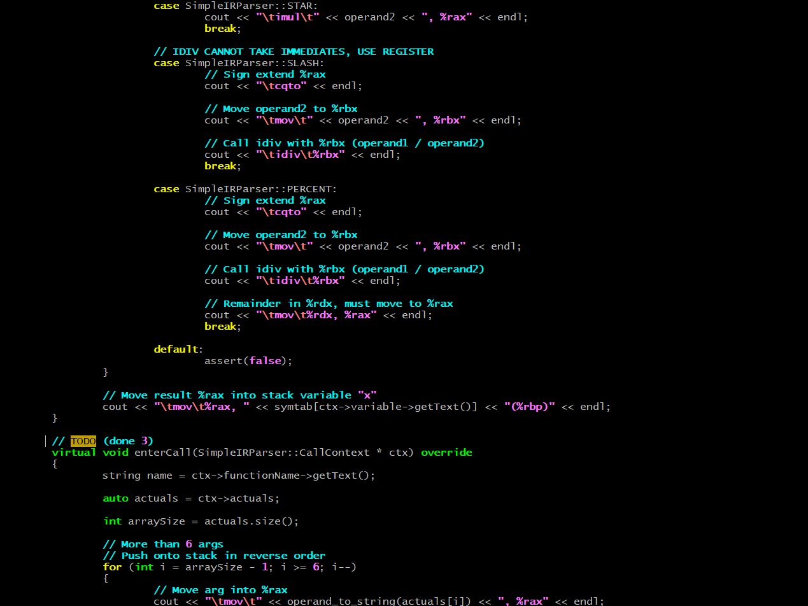
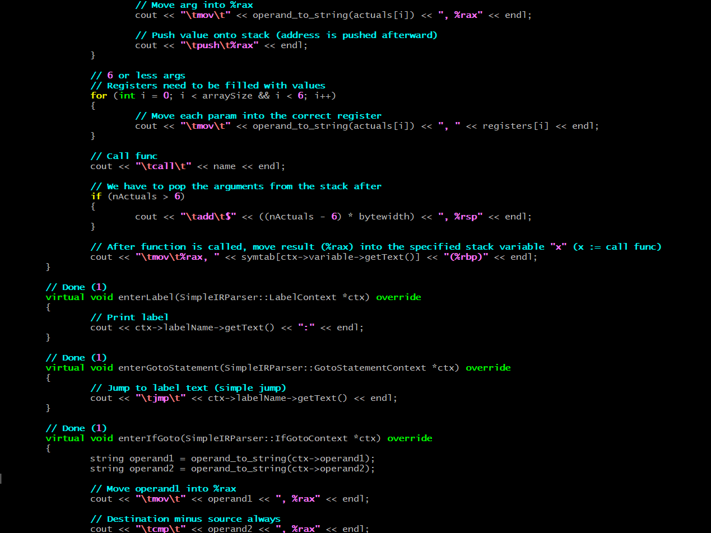
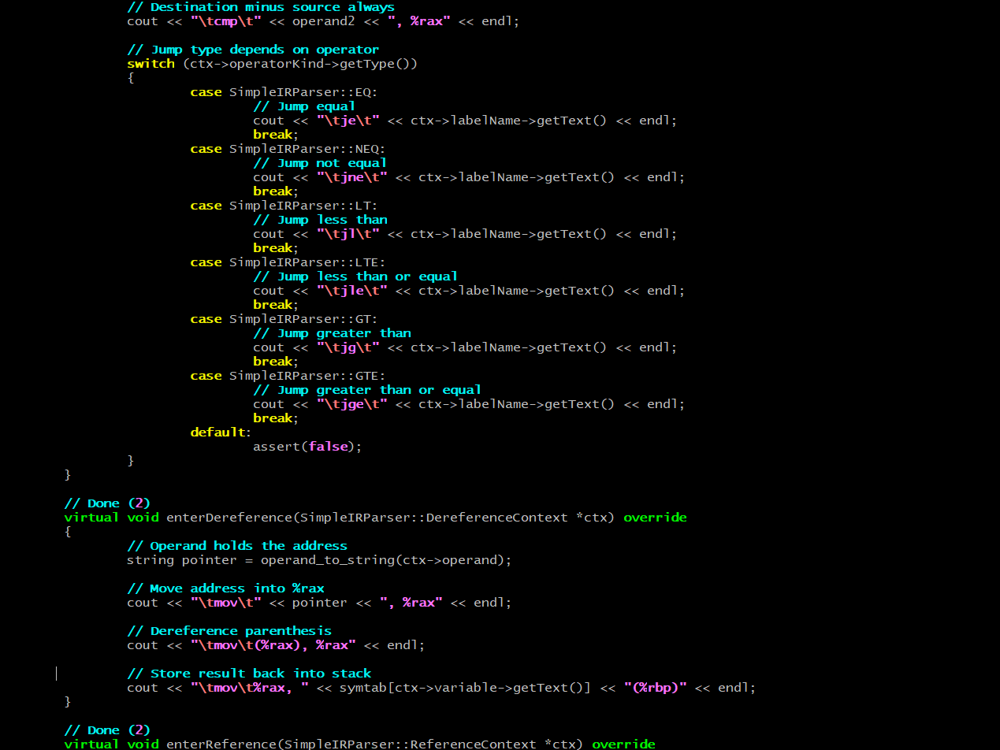
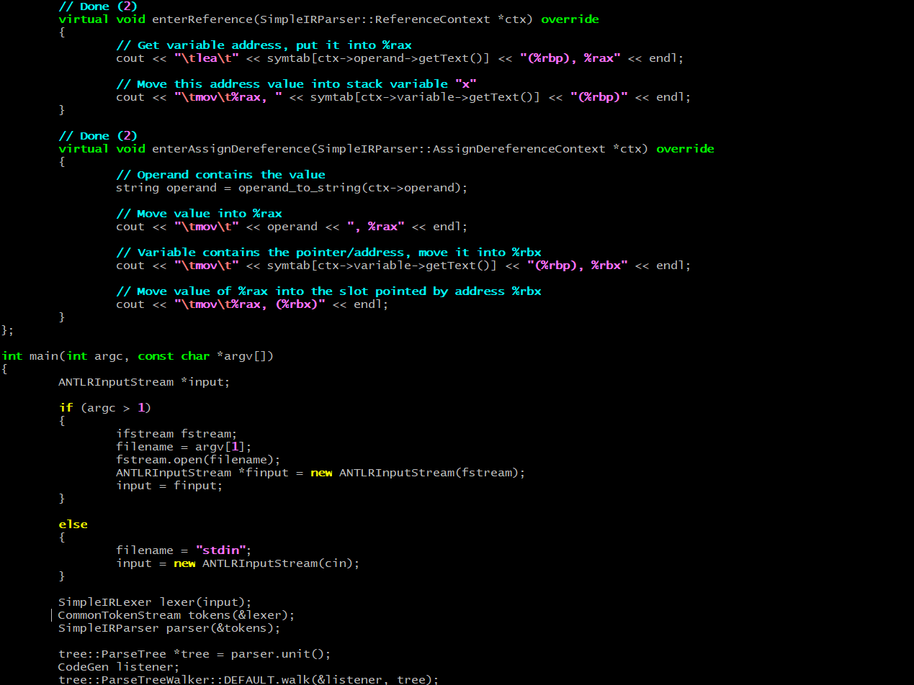

# SimpleIR to x86 Compiler

Translating human-understandable code into something the machine can use is difficult. It's been a thorn in every programmer's side since the beginning of time. 

The answer? A shit ton of set theory. Whoever came up with it is very smart.
```css
Made with C++, ANTLR-4
```


## All about grammar

I built a SimpleIR to x86 assembly compiler for a class project. As far as compilers go, this is on the easier side, since both languages use a similar line-by-line syntax. Both languages are effectively a set of "rules" that text must follow, to assemble a working program. Both have function prologues and function epilogues. Both use the same math operations. Both use jumping to specific labels. 

Like you and your coworker, who speak different languages but do the same job. All you're doing is translating the words.

Assembly code is made according to the [x86-64 System V ABI](https://wiki.osdev.org/System_V_ABI) (Application Binary Interface). The stack trends downward.



The ABI standardizes the stack frame and it's contents. From top to bottom: 
1. Arguments
2. Return address
3. Saved %RBP
4. Saved %RBX
5. Local variables
6. Padding
7. Red Zone

It also tells us how stacks should behave:
- What is each register used for?
- Should contents be preserved between function calls? (%RBP, %RBX)
- How many arguments are passed via registers?
- How many arguments are passed via stack parameters?

## Syntax trees

We can create our own rules. Function start must come before function end. Local variables must be declared before parameters. Arithmetic operations must happen between two "operands". Arithmetic operations include a symbol (%, +, -, /, asterisk).

Most programming languages use Abstract Syntax Trees. It's like the order of operations. 

- Multiplication and division are processed before adding (+) and subtracting (-).
- Values of some variables (x) must be calculated before passing to others (y).
- Values of some variables (z) depend on calling a function.

This set of rules is encoded in a grammar file, and given to the ==ANTLR parser==. This generates the syntax tree, and allows us to parse through it. SimpleIR and Assembly are both top-to-bottom languages, so we can just walk downward as each line is read.

## SimpleIR vs Assembly

Loops are easy to handle, conditional statements followed by jumps:

```assembly
cmp %rbx, %rax // Compare
jle label // Jump
```
<br>
Calling a function in SimpleIR:

```shell
x := call hello

function hello
localVariables x y
x := 5
y := x
return y
end function
```
<br>
Calling a function in x86 assembly:

```assembly
hello:

push %rbp 
mov %rsp, %rbp
push %rbx

sub $16, %rsp
...
add $16, %rsp
pop %rbx
pop %rbp

ret
```
<br>
And this isn't even half of it! We haven't:

- Pushed arguments into the correct registers
- Pushed arguments onto the stack
- Saved values of the caller-saved registers

Understandably, nobody wants to write in assembly. Setting up each stack frame is a pain in the ass. This is a problem our compiler will solve.

<br>

## Codegen








